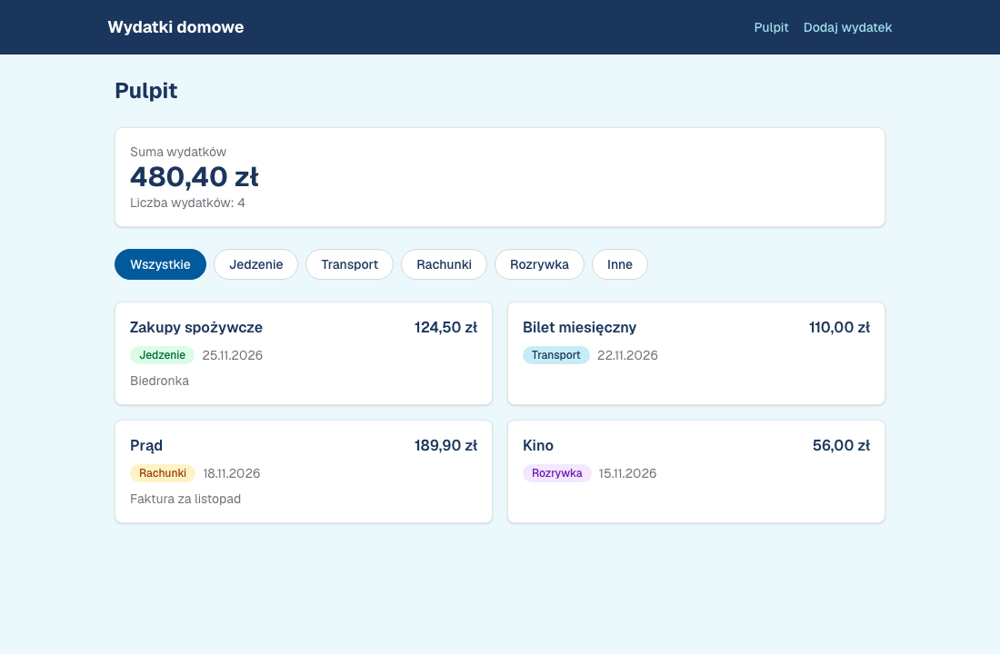
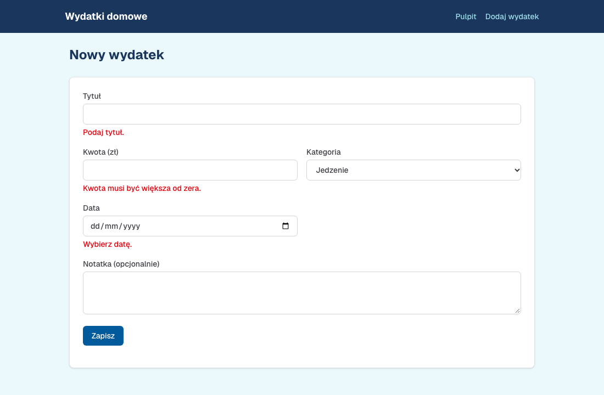
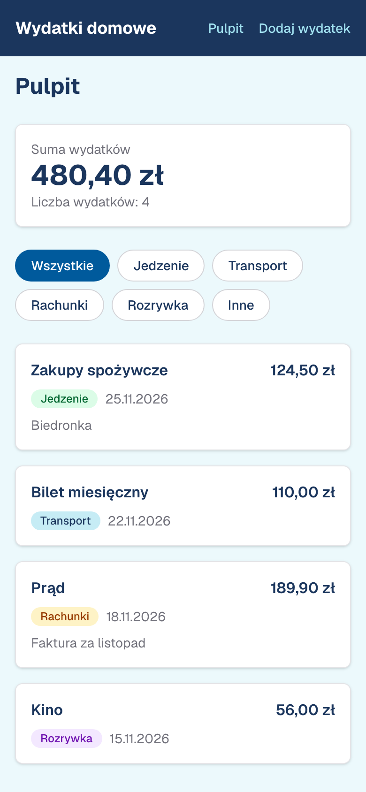

# Wydatki domowe

Projekt zaliczeniowy z przedmiotu „Frameworki programowania”.

## Opis projektu

**Temat:** Wydatki domowe – aplikacja webowa do ewidencji i kontroli budżetu osobistego.

**Dla kogo:** dla osób, które chcą zapisywać swoje codzienne wydatki i widzieć, ile i na co wydają.

**Najważniejsze funkcje:**

- dodawanie wydatku (tytuł, kwota, kategoria, data, opcjonalna notatka),
- lista wydatków na pulpicie wraz z sumą i liczbą pozycji,
- filtrowanie po kategorii,
- podgląd szczegółów, edycja i usuwanie (z potwierdzeniem),
- walidacja danych w formularzu i na serwerze,
- trwały zapis danych w bazie SQLite.

## Wykorzystane frameworki

| Nazwa        | Wersja | Kategoria               | Rola w projekcie                                                | Użyte mechanizmy                                                                                                                                  |
| ------------ | ------ | ----------------------- | --------------------------------------------------------------- | ------------------------------------------------------------------------------------------------------------------------------------------------- |
| Next.js      | 16.4.6 | A – framework aplikacji | Cała aplikacja: strony, nawigacja i API REST w jednym projekcie | App Router, Route Handlers (`app/api/...`), strona dynamiczna `/expenses/[id]`, wspólny layout, komponenty serwerowe i klienckie (`"use client"`) |
| Tailwind CSS | 4.3.3  | B – framework UI        | Cały wygląd: układ, karty, formularze, kolory, responsywność    | klasy użytkowe (`grid`, `flex`, `sm:`), własna paleta kolorów w `@theme`, integracja przez PostCSS                                                |
| Playwright   | 1.65.1 | C – framework testowy   | Testy automatyczne działającej aplikacji (API i interfejs)      | `@playwright/test`, `describe`, `beforeEach`, fixture `request` i `page`, `webServer`                                                             |

Dodatkowo: React 19.3.0, TypeScript 5.9.3 oraz `better-sqlite3` 13.2.0 (baza SQLite).

## Wymagania

- Node.js 24 (projekt rozwijany na v24.21.0) i npm
- `better-sqlite3` to moduł natywny, kompilowany pod konkretną wersję Node. Po zmianie wersji Node (np. przez nvm) uruchom `npm rebuild better-sqlite3`, inaczej serwer wyłączy się przy pierwszym zapytaniu do bazy.

## Instalacja i uruchomienie

1. Zainstaluj zależności:
    ```bash
    npm install
    ```
2. Skopiuj plik konfiguracyjny:
    ```bash
    cp .env.example .env
    ```
3. Uruchom aplikację w trybie deweloperskim (http://localhost:3000):
    ```bash
    npm run dev
    ```

Wersja produkcyjna:

```bash
npm run build
npm run start
```

**Plik `.env.example`** zawiera nazwy zmiennych środowiskowych bez poufnych wartości:

| Zmienna         | Opis                                                                                     |
| --------------- | ---------------------------------------------------------------------------------------- |
| `DATABASE_PATH` | ścieżka do pliku bazy SQLite względem katalogu projektu (domyślnie `./data/expenses.db`) |

Prawdziwy plik `.env` i baza danych (`data/`) są w `.gitignore` i nie trafiają do repozytorium. Baza i tabela tworzą się automatycznie przy pierwszym zapytaniu.

## Uruchomienie testów

Przy pierwszym uruchomieniu zainstaluj przeglądarkę dla Playwright:

```bash
npx playwright install chromium
```

Następnie uruchom testy:

```bash
npm test
```

Playwright sam buduje i uruchamia wersję produkcyjną aplikacji na porcie 3100, z osobną bazą testową (`data/test.db`), więc dane z aplikacji zostają nietknięte. Przed testami zatrzymaj `npm run dev`, bo budowanie nadpisuje folder `.next`, z którego korzysta tryb deweloperski.

Przed każdym testem (`beforeEach`) baza testowa jest czyszczona przez API.

| Grupa (`describe`)          | Plik                      | Scenariusze                                                                                                                                                       |
| --------------------------- | ------------------------- | ----------------------------------------------------------------------------------------------------------------------------------------------------------------- |
| API /api/expenses           | `tests/api.spec.ts`       | dodanie wydatku (201) i pojawienie się na liście; odrzucenie niepoprawnych danych (400, scenariusz negatywny); edycja (200); usunięcie (204) i 404 dla usuniętego |
| Strona główna (pulpit)      | `tests/pulpit.spec.ts`    | komunikat przy pustej liście; wyświetlenie listy i sumy; filtrowanie po kategorii                                                                                 |
| Formularz dodawania wydatku | `tests/formularz.spec.ts` | dodanie wydatku, który pojawia się na pulpicie; blokada pustego formularza z komunikatami (negatywny); odrzucenie ujemnej kwoty (negatywny)                       |

Razem 10 testów. Wspólne dane i czyszczenie bazy są w `tests/helpers.ts`.

## Strony aplikacji

| Adres            | Opis                                                                                                                               |
| ---------------- | ---------------------------------------------------------------------------------------------------------------------------------- |
| `/`              | **Pulpit**: suma wydatków, filtrowanie po kategorii (przyciski) i lista wydatków w kartach. Kliknięcie karty otwiera szczegóły.    |
| `/expenses/new`  | **Dodawanie wydatku**: formularz z walidacją. Po zapisie formularz się czyści i pojawia się komunikat „Zapisano wydatek.”          |
| `/expenses/[id]` | **Szczegóły wydatku** (strona dynamiczna, np. `/expenses/15`): podgląd, edycja w tym samym miejscu oraz usuwanie z potwierdzeniem. |

Interfejs obsługuje: ładowanie (`Spinner`), błędy API (obsługa w jednej funkcji `api` w `lib/api.ts`; przy pobieraniu i zapisie czerwony komunikat, przy usuwaniu okno `alert`), walidację formularza (komunikaty pod polami i blokada wysyłki), potwierdzenie usunięcia (`confirm`) oraz powiadomienia o sukcesie (`Toast`). Układ jest responsywny dzięki siatce Tailwinda.

Layout, strony i `Navbar` to komponenty serwerowe. Dyrektywę `"use client"` mają tylko `ExpensesDashboard`, `ExpenseDetails` i `ExpenseForm`, bo używają stanu i zdarzeń. Komponenty bez dyrektywy importowane przez nie (np. `ExpenseList`, `ExpenseCard`, `CategoryFilter`, `Toast`) też stają się częścią kodu klienckiego. Dane pobierane są z API przez `fetch`, więc Server Actions (`"use server"`) nie są używane.

## API REST

| Metoda | Endpoint            | Opis                                                                                                 | Kody          |
| ------ | ------------------- | ---------------------------------------------------------------------------------------------------- | ------------- |
| GET    | `/api/expenses`     | Lista wydatków. Query: `category` (filtr), `order=asc\|desc` (sortowanie po dacie, domyślnie `desc`) | 200, 400      |
| GET    | `/api/expenses/:id` | Pojedynczy wydatek                                                                                   | 200, 404      |
| POST   | `/api/expenses`     | Dodanie wydatku                                                                                      | 201, 400      |
| PUT    | `/api/expenses/:id` | Edycja (pełna – wszystkie pola jak w POST)                                                           | 200, 400, 404 |
| DELETE | `/api/expenses/:id` | Usunięcie wydatku (odpowiedź bez treści)                                                             | 204, 404      |

Pola wydatku: `id` (nadawane automatycznie), `title` (wymagany, niepusty), `amount` (liczba > 0), `category` (`Jedzenie`, `Transport`, `Rachunki`, `Rozrywka`, `Inne`), `date` (poprawna data `RRRR-MM-DD`), `note` (opcjonalna).

Błędy mają format `{ "error": "...", "details": { "pole": "komunikat" } }` (`details` tylko przy błędach walidacji).

### Przykład: `POST /api/expenses`

Żądanie:

```json
{
    "title": "Zakupy",
    "amount": 45.5,
    "category": "Jedzenie",
    "date": "2026-11-20",
    "note": "Biedronka"
}
```

Odpowiedź `201 Created`:

```json
{
    "id": 1,
    "title": "Zakupy",
    "amount": 45.5,
    "category": "Jedzenie",
    "date": "2026-11-20",
    "note": "Biedronka"
}
```

### Przykład: `GET /api/expenses?category=Jedzenie&order=asc`

Odpowiedź `200 OK`:

```json
[
    {
        "id": 1,
        "title": "Zakupy",
        "amount": 45.5,
        "category": "Jedzenie",
        "date": "2026-11-20",
        "note": "Biedronka"
    }
]
```

### Przykład błędu walidacji (`400`)

Żądanie: `{ "title": "  ", "amount": -5, "category": "X", "date": "2026-02-31" }`

```json
{
    "error": "Błąd walidacji danych.",
    "details": {
        "title": "Tytuł jest wymagany.",
        "amount": "Kwota musi być większa od zera.",
        "category": "Kategoria musi być jedną z: Jedzenie, Transport, Rachunki, Rozrywka, Inne.",
        "date": "Data musi być poprawna i mieć format RRRR-MM-DD."
    }
}
```

Nieistniejące ID (także np. `abc`) zwraca `404` z `{ "error": "Nie znaleziono wydatku." }`.

## Bezpieczeństwo

Zastosowane mechanizmy:

- **Walidacja po stronie serwera** (`lib/validation.ts`): API odrzuca puste tytuły, kwoty niebędące liczbą lub ≤ 0, nieznane kategorie i błędne daty (kod 400), niezależnie od walidacji w formularzu.
- **Zapytania parametryzowane** w `lib/db.ts` (`?` i `@pole`) chronią przed SQL injection.
- **Konfiguracja w zmiennych środowiskowych**: ścieżka do bazy w `.env`; `.env` i baza danych (`data/`, `*.db`) są w `.gitignore`, a w repozytorium jest tylko `.env.example` bez poufnych wartości.
- **Brak danych poufnych w repozytorium i historii commitów**: pliki `.env` i baza nigdy nie były dodane do Git, w kodzie nie ma haseł ani kluczy.
- **Ochrona przed XSS**: React domyślnie escapuje wyświetlane teksty, a w projekcie nie ma `dangerouslySetInnerHTML`.

**Audyt zależności** (`npm audit`):

```
found 0 vulnerabilities
```

Wynik jest taki sam dla `npm audit --omit=dev` (same zależności produkcyjne). Komentarz: żadna zależność nie ma znanych podatności w momencie oddania projektu. Wersje są przypięte w `package-lock.json`. Audyt warto powtarzać po każdej aktualizacji pakietów.

## Struktura projektu

```
app/layout.tsx                   layout z nawigacją
app/page.tsx                     pulpit
app/expenses/new/page.tsx        formularz nowego wydatku
app/expenses/[id]/page.tsx       szczegóły wydatku (strona dynamiczna)
app/api/expenses/route.ts        GET (lista, filtr, sortowanie), POST
app/api/expenses/[id]/route.ts   GET, PUT, DELETE
components/                      komponenty interfejsu
lib/db.ts                        połączenie z SQLite, tabela i zapytania SQL
lib/validation.ts                walidacja danych po stronie serwera
lib/api.ts, lib/format.ts        pomocnicze funkcje interfejsu
tests/                           testy Playwright
playwright.config.ts             konfiguracja testów
```

## Zrzuty ekranu

**Pulpit (komputer)**



**Formularz z błędami walidacji**



**Widok na telefonie**


